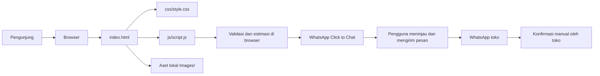

# Arsitektur Sistem — Milk TeaND

## 1. Gaya arsitektur

Milk TeaND saat ini menggunakan **situs statis monolitik sisi klien**: satu halaman HTML memuat konten, stylesheet, dan skrip browser. Tidak ada service backend, database, antrean, atau microservice dalam struktur proyek yang ditinjau.

## 2. Diagram komponen



Hosting static site, bila dikonfigurasi, hanya menyajikan file statis ke browser. Provider tersebut belum ditentukan atau dikonfigurasi dalam proyek saat ini.

## 3. Komponen

| Komponen | Tanggung jawab | Sumber |
|---|---|---|
| Presentasi/konten | Bagian beranda, cerita, produk, keunggulan, pemesanan, kontak, footer | `index.html` |
| Gaya | Warna, tipografi, layout responsif, fokus, state formulir, animasi | `css/style.css` |
| Interaksi | Menu mobile, scroll state, navigasi aktif, reveal, validasi dan penyusunan pesan pesanan | `js/script.js` |
| Aset | Logo dan gambar produk; beberapa menu memakai foto produk yang sudah ada | `Images/` |
| Keranjang | Menyimpan jumlah item selama halaman terbuka, merender subtotal/total, dan membentuk ringkasan checkout | `Map` di memori pada `js/script.js` |
| WhatsApp | Membuka Click to Chat dengan detail seluruh item di keranjang | tautan `wa.me` dari browser |

## 4. Alur data dan pemesanan

1. Browser mengunduh halaman, stylesheet, skrip, dan gambar dari lokasi hosting statis.
2. JavaScript merender 20 kartu katalog dari data produk yang disimpan di `js/script.js`.
3. Pengguna menambah produk ke keranjang; jumlah setiap produk dibatasi 1–99.
4. JavaScript menghitung subtotal dan total dari harga produk dan jumlah di keranjang.
5. Pengguna memasukkan nama, nomor WhatsApp, serta catatan opsional.
6. JavaScript memvalidasi data, membentuk satu ringkasan pesanan, meng-encode teks, lalu menavigasi browser ke URL WhatsApp `wa.me`.
7. Pengguna meninjau dan mengirim pesan sendiri melalui WhatsApp. Toko mengonfirmasi secara manual.

Tidak ada penyimpanan pesanan pada website. Data yang dimasukkan berada di browser sampai pengguna mengirimkannya lewat WhatsApp; begitu dikirim, penanganan pesan mengikuti layanan dan perangkat WhatsApp.

## 5. Model data konseptual

Tidak ada skema database pada implementasi saat ini. Berikut model konseptual untuk data yang ditampilkan atau disusun di browser:

```text
Produk
  id: number
  nama: string
  deskripsi: string
  hargaRupiah: integer
  topping: string[]
  bonusPhotocard: string[]
  gambar: path

DetailPesanan (sementara di browser)
  namaPelanggan: string
  nomorWhatsApp: string
  photocard: string
  items: [{ produkId: number, jumlah: integer (1..99), subtotalRupiah: integer }]
  catatan: string
  totalRupiah: integer
```

`Produk` didefinisikan sebagai array statis di `js/script.js`. `DetailPesanan` dan `Keranjang` hanya berada di memori halaman; tidak ada penyimpanan permanen. Menu tambahan dan harganya perlu persetujuan pemilik.

## 6. Integrasi pihak ketiga

### WhatsApp Click to Chat

- Integrasi yang dituju adalah tautan `https://wa.me/<nomor>?text=<pesan-ter-encode>`.
- Pengguna tetap harus menekan tombol kirim di aplikasi atau web WhatsApp.
- Tidak ada konfirmasi penerimaan otomatis dari toko, API resmi, atau webhook.
- Nomor tujuan harus dikonfirmasi pemilik dan diuji sebelum publikasi.

### Tidak ada integrasi yang ditemukan

Tidak ditemukan payment gateway, analytics, database, CRM, layanan email, atau API pengiriman.

## 7. Batasan dan risiko teknis yang diketahui

- Formulir bukan sistem checkout dan tidak menjamin stok, harga terkini, atau penerimaan pesanan.
- Harga ditulis di beberapa tempat; perubahan harus konsisten agar total tidak berbeda dari katalog.
- Isi keranjang hilang saat halaman dimuat ulang atau ditutup.
- Lima belas menu tambahan dan harganya adalah usulan sementara, bukan informasi yang telah dikonfirmasi pemilik.
- Hosting, domain, proses deployment, monitoring, dan pencadangan repository belum dikonfirmasi.

## 8. Evolusi yang disarankan

1. Konfirmasi nama, deskripsi, topping, harga, dan foto semua menu dengan pemilik.
2. Uji alur multi-item, validasi, total, dan pengalihan WhatsApp pada perangkat mobile dan desktop.
3. Tambahkan pemeriksaan tautan aset, validasi konten, dan smoke test sebelum publikasi.
4. Pertimbangkan konfigurasi CI untuk pemeriksaan otomatis dan deployment statis setelah lokasi hosting diputuskan.
5. Hanya tambahkan backend/database jika dibutuhkan untuk persistensi, pembayaran, inventori, atau pengelolaan pesanan terpusat.
